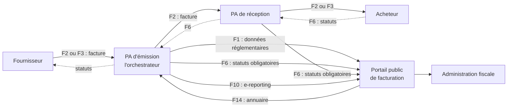
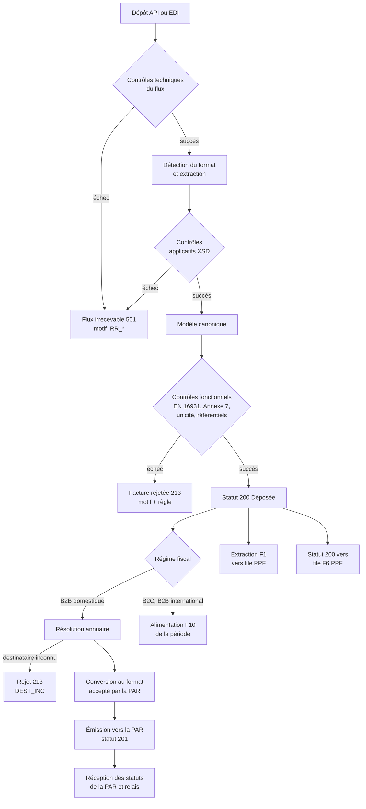
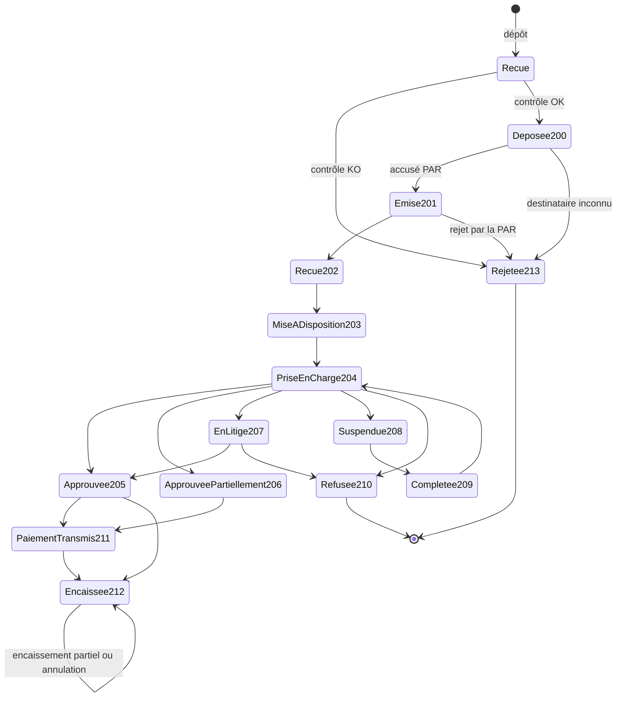
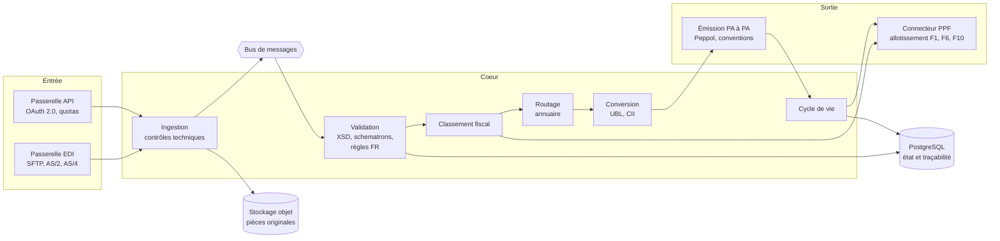

# Spécification technico-fonctionnelle : orchestrateur de validation et d'émission de factures

| Élément | Valeur |
|---|---|
| Produit | Orchestrateur de la plateforme agréée (PA) d'émission |
| Version du document | 0.1, brouillon pour revue |
| Date | 02/11/2026 |
| Référentiel réglementaire | Spécifications externes de la facturation électronique v3.2 du 30/04/2026 (`Refs/specifications-v3.2/`) |
| Annexes utilisées | Annexe 1 (flux 1) v1.2, Annexe 2 (cycle de vie) v2.3, Annexe 3 (annuaire) v1.8, Annexe 6 (e-reporting) v1.10, Annexe 7 (règles de gestion) v1.9 |
| Modèle de données de départ | `db/` (schéma PostgreSQL `vente`) |

**Conventions de renvoi.** « DSE §x » renvoie au dossier général v3.2. « Gx.y », « Sx.y » et « P1.x » sont les règles de gestion de l'Annexe 7. « BR-x » sont les règles de la norme EN 16931. « BT-x » et « BG-x » sont ses termes métier. « EF-x » et « ENF-x » sont les exigences propres à ce document.

**Statut des affirmations.** Ce qui vient des spécifications v3.2 est cité avec sa source. Ce qui relève d'un choix de conception est signalé comme **proposition**. Ce qui dépend des normes AFNOR XP Z12-012, Z12-013 et Z12-014, non disponibles dans `Refs/`, est signalé comme **à confirmer** et récapitulé au chapitre 14.

---

## 1. Objet et périmètre

### 1.1 Objet

L'orchestrateur est le cœur d'une plateforme agréée d'émission (PAE). Il reçoit une facture d'un fournisseur au format XML ou JSON, la contrôle, puis :

1. si la facture est conforme, il l'émet vers la plateforme agréée de réception (PAR) de l'acheteur, trouvée dans l'annuaire ;
2. il extrait les données réglementaires (flux F1) et les transmet au portail public de facturation (PPF) ;
3. il produit et relaie le cycle de vie de la facture (flux F6) ;
4. si la facture relève du e-reporting, il alimente les déclarations agrégées (flux F10) au lieu de l'émettre.

### 1.2 Dans le périmètre

- Réception par API REST et par EDI (SFTP, AS/2, AS/4).
- Formats d'entrée : UBL 2.1, CII D22B, Factur-X (XML embarqué dans un PDF/A-3) et un JSON canonique décrit au chapitre 8.
- Contrôles techniques, applicatifs et fonctionnels ; détermination du régime fiscal.
- Routage par l'annuaire central, conversion de format, émission vers la PAR.
- Production des flux F1, F6 et F10 vers le PPF, avec allotissement.
- Suivi du cycle de vie et notification du fournisseur.

### 1.3 Hors périmètre

- Le rôle de plateforme de réception (PAR) : réception de factures pour le compte d'acheteurs et actualisation de l'annuaire (F12, F13).
- La création des factures : elle reste dans le système du fournisseur, par exemple la boutique de `db/`.
- L'archivage à valeur probante au-delà du stockage des pièces (voir ENF-SEC-06).
- Le B2G par Chorus Pro, qui suit un circuit propre.
- Les opérations où le déclarant est l'acheteur (Bi2B).

---

## 2. Contexte réglementaire

### 2.1 Le schéma en Y

Chaque entreprise choisit une plateforme agréée. La facture circule d'une PA à l'autre ; seules les données réglementaires et les statuts obligatoires remontent au PPF, qui les transmet à l'administration fiscale (DSE §2.3.8).



### 2.2 Obligations de la PA d'émission

Selon le DSE §2.3.8, la PAE doit :

- émettre la facture vers la plateforme du destinataire référencée dans l'annuaire, et en permettre le suivi ;
- extraire et transmettre au PPF les données réglementaires et les statuts obligatoires ;
- transmettre les données de e-reporting ;
- garantir le routage correct, la qualité, l'intégrité, l'authenticité et l'exhaustivité des données, ainsi que leur conformité fiscale.

Elle doit aussi être raccordée au PPF et à au moins une autre PA. Le réseau Peppol est reconnu comme infrastructure d'interopérabilité ; il devient obligatoire lorsque deux PA ne parviennent pas à échanger autrement et que l'une d'elles l'utilise (DSE §2.3.10).

### 2.3 Calendrier

| Date | Obligation | Source |
|---|---|---|
| 01/09/2026 | Réception électronique pour tous les assujettis ; émission pour les grandes entreprises et les ETI ; données « DEMARRAGE » obligatoires | DSE §2.3.5, G6.08 |
| 01/09/2027 | Émission pour tous les assujettis ; données « CIBLE » obligatoires (profil F1 « Full ») | DSE §2.3.5, G6.09 |

L'orchestrateur doit donc gérer les deux trajectoires en parallèle, selon la date de la facture et l'assujetti (EF-F1-03).

### 2.4 Flux traités

| Flux | Sens | Contenu | Format | Code interface PPF |
|---|---|---|---|---|
| F2 | Fournisseur → PAE → PAR | Facture du socle | UBL, CII, Factur-X | Sans objet (PA à PA) |
| F3 | Fournisseur → PAE | Facture hors socle (ici : JSON) | Libre | Sans objet |
| F1 | PAE → PPF | Données réglementaires | UBL ou CII | `FFE0111A` (UBL), `FFE0112A` (CII) |
| F6 | PAE ↔ PAR, PAE → PPF | Cycle de vie | CDAR | `FFE0614A` (factures) |
| F10 | PAE → PPF | Transactions et paiements | Format spécifique | `FFE1025A` |
| F14 | PPF → PAE | Export de l'annuaire | Format spécifique | `FFE1435A` |

Source : DSE §3.2 et §3.4.5, tableau 4.

---

## 3. Glossaire

| Terme | Définition |
|---|---|
| PA, PAE, PAR | Plateforme agréée ; d'émission (agit pour le fournisseur) ; de réception (agit pour l'acheteur) |
| PPF | Portail public de facturation : annuaire central et concentrateur des données fiscales |
| Flux | Enveloppe transmise (archive `tar.gz` ou fichier `xml`) contenant un ou plusieurs fichiers |
| Objet métier | Une facture, un jeu de données réglementaires, un statut, une transmission e-reporting |
| Dépôt | Remise d'une facture à l'orchestrateur, par API ou EDI |
| Irrecevabilité | Le flux ne peut pas être traité (virus, vide, nommage, syntaxe) ; statut de flux 501 |
| Rejet | Une facture ne passe pas les contrôles fonctionnels de la plateforme ; statut 213 |
| Refus | Le destinataire refuse la facture pour un motif métier ; statut 210 |
| Matricule | Identifiant à 4 caractères d'une PA, schéma `0238` (G1.73) |
| Modèle canonique | Représentation interne d'une facture, indépendante de sa syntaxe, organisée par BT |

---

## 4. Vue d'ensemble du traitement



Les flux vers le PPF partent par lots (EF-PPF-02) ; l'émission vers la PAR, elle, est unitaire.

---

## 5. Exigences fonctionnelles

### 5.1 Réception

| ID | Exigence | Source |
|---|---|---|
| EF-REC-01 | L'orchestrateur accepte les dépôts par API REST (chapitre 8) et par EDI (SFTP, AS/2, AS/4). | DSE §2.3.10 |
| EF-REC-02 | Il accepte les syntaxes UBL 2.1, CII D22B, Factur-X (profils au moins EN 16931 et EXTENDED) et le JSON canonique. | DSE §2.3.10 et §3.6.3 ; DSE v2.1 §3.2.4 pour les profils ; proposition pour le JSON |
| EF-REC-03 | Chaque dépôt reçoit un identifiant unique et un horodatage de réception, renvoyés immédiatement à l'émetteur. | Proposition |
| EF-REC-04 | Un dépôt API porte un en-tête `Idempotency-Key`. Un second dépôt avec la même clé et le même contenu renvoie le résultat du premier, sans nouveau traitement. | Proposition |
| EF-REC-05 | Le fichier reçu est conservé tel quel, avec son empreinte SHA-256, avant toute transformation. | DSE §2.3.8 (intégrité) |
| EF-REC-06 | Un dépôt EDI contient des fichiers d'une seule nature et d'un seul format ; extensions admises `tar.gz` et `xml` ; 1 Go au plus par flux et 100 Mo par fichier. | DSE §3.4.2, notes 65 à 67 |
| EF-REC-07 | Le nom d'un flux EDI suit la convention `<code interface>_<code application>_<identifiant de flux>`. L'identifiant compte 25 caractères : 6 pour le code application de l'émetteur et 19 pour un numéro de séquence (chiffres ou majuscules). | DSE §3.4.5, G7.33 |

**Le cas du JSON.** Le JSON ne fait pas partie du socle (UBL, CII, Factur-X). Une facture reçue en JSON est donc un flux F3 : elle est acceptée en entrée, mais ne circule jamais telle quelle entre plateformes. L'orchestrateur la convertit dans un format du socle avant toute émission (EF-CNV-01). Le JSON canonique (§8.3) reprend les identifiants BT de la norme, ce qui rend la conversion déterministe.

### 5.2 Contrôles techniques du flux

Ils s'appliquent au flux et à chaque fichier, dans cet ordre (DSE §3.4.2). Un échec rend le **flux** irrecevable (statut 501) ; aucune facture n'est créée.

| ID | Contrôle | Motif en cas d'échec |
|---|---|---|
| EF-TEC-01 | Analyse antivirus du flux et des pièces jointes | `IRR_ANTIVIRUS` |
| EF-TEC-02 | Flux, fichiers et pièces jointes non vides | `IRR_VIDE`, `IRR_VIDE_F`, `IRR_VID_PJ` |
| EF-TEC-03 | Type et extension du flux, des fichiers et des pièces jointes | `IRR_TYPE`, `IRR_TYPE_F`, `IRR_EXT_DOC` |
| EF-TEC-04 | Taille du flux, des fichiers et des pièces jointes | `IRR_TAILLE`, `IRR_TAILLE_F`, `IRR_TAILLE_PJ` |
| EF-TEC-05 | Nommage de l'enveloppe, des fichiers et des pièces jointes | `IRR_FORM`, `IRR_NOM_F`, `IRR_NOM_PJ` |
| EF-TEC-06 | Extraction de l'archive | `IRR_EXTRAC` |
| EF-TEC-07 | Unicité du flux (même identifiant déjà reçu) | `IRR_UNICITE` |
| EF-TEC-08 | Raccordement connu pour le code application | `IRR_CODE_APP` |
| EF-TEC-09 | Code interface connu | `IRR_CODE_INTER` |

Libellés : Annexe 7, G7.18 et DSE §3.4.4, tableau 3. Le tableau 3 écrit `IRR_UNCITE` et la règle G7.18 `IRR_UNICITE` ; l'orchestrateur retient la graphie de G7.18.

### 5.3 Détection du format et contrôles applicatifs

| ID | Exigence | Source |
|---|---|---|
| EF-APP-01 | Le format est détecté par le contenu, pas par l'extension : élément racine `Invoice` ou `CreditNote` (UBL), `CrossIndustryInvoice` (CII), PDF avec pièce jointe `factur-x.xml` (Factur-X), document JSON portant `"format": "canonique-en16931"`. | Proposition |
| EF-APP-02 | Le fichier est validé contre son XSD (UBL 2.1, CII D22B) ou son schéma JSON. Un échec rend le flux irrecevable avec le motif `IRR_SYNTAX` et le nom de la donnée en erreur. | DSE §3.4.3, G7.18 |
| EF-APP-03 | Les fichiers XML sont encodés en UTF-8. | DSE §3.4.2, note 67 |
| EF-APP-04 | Le parseur désactive la résolution des entités externes et des DTD (protection contre les attaques XXE et « billion laughs »). | Proposition (sécurité) |
| EF-APP-05 | Le fichier est converti dans le modèle canonique. Pour Factur-X, le XML embarqué est extrait et le PDF conservé comme représentation lisible. | DSE §3.2.4 (v2.1) |

### 5.4 Contrôles fonctionnels

Ils portent sur **chaque facture**. Un échec la rejette (statut 213) ; les autres factures du même flux continuent leur traitement.

| ID | Exigence | Source | Motif |
|---|---|---|---|
| EF-FON-01 | Application des règles de la norme EN 16931 (BR, BR-CO, BR par catégorie de TVA), par les schematrons officiels du CEN. | DSE §3.6.7, note 106 | `REJ_SEMAN` |
| EF-FON-02 | Application des règles de gestion françaises de l'Annexe 7 (règles G, S et P marquées applicables au F1). | Annexe 7 | `REJ_SEMAN` |
| EF-FON-03 | Contrôle de cohérence avec les référentiels : types de facture (G1.01), cadres (G1.02), devises (G1.10), taux (G1.24), catégories de TVA (G2.31), codes VATEX, unités, pays (G2.01). | DSE §3.6.7, note 108 | `REJ_COH` |
| EF-FON-04 | Contrôle d'unicité : numéro de facture (BT-1), SIREN du vendeur (BT-30) et année d'émission (BT-2) ne doivent pas correspondre à une facture déjà acceptée. Une facture précédemment rejetée n'entre pas dans le contrôle. | G1.45 | `REJ_UNI`, `DOUBLON` |
| EF-FON-05 | Le SIREN du vendeur et celui de l'acheteur sont présents, avec le schéma `0002`, et existent dans l'annuaire. | G1.63 | `REJ_COH` |
| EF-FON-06 | Le SIRET éventuel commence par le SIREN du même bloc. | G1.80 | `REJ_COH` |
| EF-FON-07 | Les montants ont au plus 2 décimales, les quantités 4 et les prix 6 ; un prix n'est jamais négatif. | G1.14, G1.15, G1.16 | `REJ_SEMAN` |
| EF-FON-08 | Les données « DEMARRAGE » sont exigées dès le 01/09/2026, les données « CIBLE » à partir du 01/09/2027. | G6.08, G6.09 | `REJ_SEMAN` |

Chaque anomalie est tracée avec la règle en cause, la ou les données concernées et un message explicite (G7.29). Le contrôle ne s'arrête pas à la première erreur : il les rapporte toutes, pour que l'émetteur corrige en une fois.

**Règles à implémenter en priorité.** La liste ci-dessous est déjà couverte par `db/controles.sql`, qui sert de référence de comportement et de jeu d'essai :

| Famille | Règles |
|---|---|
| Présence | BR-6, BR-7, BR-9, BR-11, BR-16, BR-55, BR-CO-26, BR-62, BR-63 |
| Calcul | BR-CO-10 à BR-CO-17, contrôle de BT-131 par ligne, base par groupe de TVA |
| Paiement | BR-CO-25, BR-61 |
| Catégories de TVA | BR-IC-2, BR-IC-11, BR-IC-12, BR-AE-2, BR-G-2, BR-O-2, BR-x-10 (motifs d'exonération) |
| Règles françaises | G1.02, G1.05, G1.12, G1.24, G1.31, G1.60, G1.63 |

### 5.5 Détermination du régime fiscal

Après le statut 200, l'orchestrateur classe la facture. Ce classement décide de la suite.

| Acheteur | Régime | Suite | Source |
|---|---|---|---|
| Assujetti établi en France | E-invoicing (B2B domestique) | Émission vers la PAR, F1 et F6 vers le PPF | DSE §3.6.1 |
| Assujetti non établi en France | E-reporting B2B international | Pas de F1 ni de F6 au PPF ; données de la facture dans le F10 | DSE §3.2, notes 30 et 31 |
| Non-assujetti | E-reporting B2C | Pas de F1 ni de F6 ; cumul journalier dans le F10 | DSE §3.2, notes 32 et 33 |

**EF-REG-01.** Le classement repose sur l'acheteur : SIREN et adresse en France signifient un assujetti établi en France. En cas de doute, par exemple un SIREN absent pour un acheteur français, la facture est rejetée plutôt qu'orientée vers le e-reporting.

**EF-REG-02.** Une entité sans SIREN, absente de l'annuaire, relève du e-reporting comme un non-assujetti (DSE §2.3.3, tolérances).

### 5.6 Routage par l'annuaire

| ID | Exigence | Source |
|---|---|---|
| EF-ANN-01 | L'orchestrateur maintient une copie locale de l'annuaire : chargement initial par le flux complet hebdomadaire (nuit du dimanche au lundi), puis application du flux différentiel émis toutes les 24 heures. | DSE §3.5.4 |
| EF-ANN-02 | Une consultation en ligne par l'API annuaire du PPF (swagger `ppf-openapi-annuaire-api-public` 1.11.0) sert de secours quand la copie locale ne trouve pas le destinataire. | DSE §3.5.4 ; `Refs/specifications-v3.2/extrait/4- Swagger_v3.2/` |
| EF-ANN-03 | La recherche suit la maille la plus fine disponible : adresse électronique BT-49 si elle est renseignée, puis code routage, SIRET et SIREN de BT-46 et BT-47. Seules les lignes en vigueur à la date de traitement sont retenues ; une ligne de masquage annule la ligne de définition correspondante. | DSE §3.5.3 ; DSE v2.1 §5.5.2 |
| EF-ANN-04 | Le résultat est le matricule de la PAR (4 caractères, schéma `0238`) et ses paramètres de raccordement. | G1.73, G7.54 |
| EF-ANN-05 | Un destinataire introuvable entraîne le rejet de la facture (statut 213, motif `DEST_INC`). | Annexe 7, motifs |
| EF-ANN-06 | Si la PAR trouvée est la plateforme elle-même, la facture est remise directement à l'acheteur, sans passer par un réseau. | Proposition |

### 5.7 Conversion de format

| ID | Exigence | Source |
|---|---|---|
| EF-CNV-01 | Une facture reçue en JSON ou dans un format hors socle est convertie dans un format du socle avant émission. | DSE §3.2 (F2, F3) |
| EF-CNV-02 | Le format cible est celui accepté par la PAR, connu par la convention de raccordement ; à défaut, UBL 2.1. | Proposition |
| EF-CNV-03 | Une conversion garantit l'intégrité des données entre le format d'origine et le format converti : elle est réversible sur toutes les BT présentes, et la facture convertie repasse les contrôles fonctionnels avant émission. | DSE §2.3.8, note 19 |
| EF-CNV-04 | La table de correspondance BT → XPath UBL et BT → XPath CII suit l'Annexe 1 pour le F1 et la norme AFNOR XP Z12-012 pour le F2. | Annexe 1 ; à confirmer pour le F2 |

### 5.8 Émission vers la PAR

| ID | Exigence | Source |
|---|---|---|
| EF-EMI-01 | L'émission passe par le canal convenu avec la PAR : convention bilatérale (SFTP, AS/2, AS/4, API) ou réseau Peppol. | DSE §2.3.10 |
| EF-EMI-02 | Un accusé de prise en charge de la PAR fait passer la facture au statut 201 « Émise par la plateforme ». | DSE §3.6.4, tableau 8 |
| EF-EMI-03 | En cas d'échec technique, l'émission est rejouée avec un délai croissant (1 min, 5 min, 30 min, 2 h, puis toutes les 6 h) pendant 72 heures. Au-delà, la facture passe en anomalie d'acheminement et l'exploitation est alertée. | Proposition |
| EF-EMI-04 | Une facture n'est émise qu'une fois par PAR : la clé d'idempotence de l'émission est l'identifiant interne de la facture. | Proposition |

### 5.9 Données réglementaires F1 vers le PPF

| ID | Exigence | Source |
|---|---|---|
| EF-F1-01 | Un F1 est produit pour chaque facture e-invoicing au statut 200, et uniquement pour elles. Une facture rejetée ou refusée ne produit pas de F1. | DSE §3.6.4 |
| EF-F1-02 | Le F1 est produit en UBL ou en CII, selon les correspondances de l'Annexe 1. | DSE §3.6.3 |
| EF-F1-03 | Chaque fichier F1 est nommé `Base_<nom>.xml` en trajectoire de démarrage et `Full_<nom>.xml` en trajectoire cible ; la casse compte. Les deux profils peuvent cohabiter dans un même flux. | S1.06, DSE §3.4.4, note 71 |
| EF-F1-04 | Le F1 parvient au PPF dans les 24 heures qui suivent le statut 200. | DSE §3.6.5 |
| EF-F1-05 | Les statuts 250 « Déposée » et 251 « Rejetée » renvoyés par le PPF sont rattachés à la facture. Un 251 déclenche une alerte : la facture a été émise, mais ses données fiscales ne sont pas prises en compte. | DSE §3.6.8, tableau 9 |

### 5.10 Cycle de vie

**Statuts d'une facture (DSE §3.6.4, tableau 8).** Seuls les statuts obligatoires sont transmis au PPF (G7.44).

| Code | Libellé | Caractère | Produit par |
|---|---|---|---|
| 200 | Déposée | Obligatoire | PAE, après contrôle conforme |
| 201 | Émise par la plateforme | Facultatif | PAE |
| 202 | Reçue par la plateforme | Facultatif | PAR |
| 203 | Mise à disposition | Facultatif | PAR |
| 204 | Prise en charge | Facultatif | Destinataire |
| 205 | Approuvée | Facultatif | Destinataire |
| 206 | Approuvée partiellement | Facultatif | Destinataire |
| 207 | En litige | Facultatif | Destinataire |
| 208 | Suspendue | Facultatif | Destinataire |
| 209 | Complétée | Facultatif | Fournisseur |
| 210 | Refusée | Obligatoire | Destinataire |
| 211 | Paiement transmis | Facultatif | Destinataire |
| 212 | Encaissée | Obligatoire | Fournisseur |
| 213 | Rejetée | Obligatoire | PAE ou PAR |



`Recue` est un état interne à l'orchestrateur : la facture n'a pas encore de statut réglementaire. Le statut 200 atteste qu'elle est contrôlée et conforme (DSE §3.6.4).

| ID | Exigence | Source |
|---|---|---|
| EF-CDV-01 | Le cycle de vie est échangé au format CDAR (UN/CEFACT SCRDM CI Cross Domain Application Response). | DSE §3.2, note 29 |
| EF-CDV-02 | Les statuts obligatoires parviennent au PPF dans les 24 heures qui suivent leur horodatage. | DSE §3.6.6 |
| EF-CDV-03 | Un statut 210 ou 213 porte un code motif (MDT-113) ; un 210 ou un 208 porte en plus un commentaire (MDT-126). Les motifs de refus sont ceux de l'Annexe 7, onglet « Tableau des motifs de refus ». | G7.08, G7.25 |
| EF-CDV-04 | Un statut 212 porte le montant encaissé, ventilé par taux de TVA, sinon le PPF le rejette (`REJ_ENCAISSEMENT`). Un remboursement ou une annulation d'encaissement s'exprime par un montant négatif, avec le motif en commentaire. | G7.45, P1.15, P1.17 |
| EF-CDV-05 | Le statut 212 n'est obligatoire que pour les prestations de services hors option pour la TVA sur les débits, et pour les factures d'acompte. | DSE §2.3.2 |
| EF-CDV-06 | L'orchestrateur relaie au fournisseur les statuts reçus de la PAR, et à la PAR les statuts déposés par le fournisseur (209, 212). | DSE §3.2 (F6) |
| EF-CDV-07 | Un statut incohérent avec la chronologie est refusé. Exemples : un 212 sur une facture rejetée, un 205 avant le 200. | DSE §3.6.4 (chronologie) |
| EF-CDV-08 | Après un 210 ou un 213, le fournisseur doit procéder à une annulation comptable par avoir interne ; cette annulation ne produit pas de F1. L'orchestrateur le rappelle dans la notification. | DSE §3.6.4 |

### 5.11 E-reporting F10

| ID | Exigence | Source |
|---|---|---|
| EF-ERP-01 | Les factures B2C sont cumulées par jour de réalisation de l'opération, catégorie de transaction (TLB1, TPS1, TNT1, TMA1) et taux, sans donnée personnelle. | G1.68 ; DSE §3.7.7 ; fiche e-reporting |
| EF-ERP-02 | Une facture double déclare séparément ses biens (TLB1) et ses services (TPS1). | Annexe 6, onglet de correspondance |
| EF-ERP-03 | Une opération soumise à une TVA étrangère déclare uniquement son montant HT, avec le code S et un taux de 0. | DSE §2.3.3 |
| EF-ERP-04 | Les transactions et les paiements sont transmis dans deux transmissions distinctes. | G6.29 |
| EF-ERP-05 | Les périodes et délais suivent le régime de TVA du déclarant : par décade pour le régime réel mensuel, mensuellement pour le réel trimestriel et le régime simplifié, par bimestre pour la franchise en base. | DSE §3.7.7, tableau 13 |
| EF-ERP-06 | Une transmission est de type `IN` (initiale) ou `RE` (rectificative) ; son identifiant, de 50 caractères au plus, est unique par déclarant et par période. | G8.01, G8.05, G7.34 |
| EF-ERP-07 | Aucune transmission n'est émise pour une période sans opération. | DSE §2.3.3 (pas de e-reporting à blanc) |

La vue `v_ereporting_b2c_jour` de `db/` produit déjà le cumul de EF-ERP-01 à EF-ERP-03.

### 5.12 Notification et consultation

| ID | Exigence | Source |
|---|---|---|
| EF-NOT-01 | Le fournisseur est notifié de chaque changement d'état : par webhook signé, par flux CDAR en EDI, ou par consultation de l'API. | Proposition |
| EF-NOT-02 | Une notification de rejet liste toutes les anomalies, chacune avec la règle, la donnée en cause et un message lisible. | G7.29 |
| EF-NOT-03 | Le fournisseur peut consulter à tout moment le statut et l'historique complet d'une facture. | DSE §2.3.8 (suivi) |

---

## 6. Catalogue des effets d'un échec

| Niveau | Portée | Statut produit | Exemples de motifs | Action attendue de l'émetteur |
|---|---|---|---|---|
| Technique | Le flux entier | 501 Irrecevable | `IRR_ANTIVIRUS`, `IRR_NOM_F` | Corriger puis renvoyer le flux, avec les mêmes numéros de facture |
| Applicatif | Le flux entier | 501 Irrecevable | `IRR_SYNTAX` | Corriger puis renvoyer le flux, avec les mêmes numéros de facture |
| Fonctionnel | Une facture | 213 Rejetée | `REJ_SEMAN`, `REJ_COH`, `REJ_UNI` | Émettre une nouvelle facture (nouveau numéro) et annuler l'ancienne par avoir interne |
| Adressage | Une facture | 213 Rejetée | `DEST_INC` | Corriger l'adressage, ou faire mettre à jour l'annuaire |
| Métier | Une facture | 210 Refusée, émis par l'acheteur | `MONTANT_ERR`, `TX_TVA_ERR` | Émettre un avoir et une nouvelle facture |

Les actions viennent du DSE v2.1 §2.8.4.3 et sont cohérentes avec le DSE v3.2 §3.6.4.

---

## 7. Architecture technique

### 7.1 Composants



### 7.2 Principes

| ID | Exigence | Source |
|---|---|---|
| ET-ARC-01 | Les étapes communiquent par un bus de messages persistant ; chaque étape est idempotente et peut être rejouée sans effet de bord. | Proposition |
| ET-ARC-02 | Les messages vers l'extérieur (PAR, PPF, webhooks) passent par une table d'envoi transactionnelle (motif « outbox ») : l'état de la facture et le message sortant sont écrits dans la même transaction. | Proposition |
| ET-ARC-03 | Les moteurs de validation sont versionnés : chaque résultat de contrôle enregistre la version des schematrons et de l'Annexe 7 appliquée. | Proposition ; DSE §3.6.7 |
| ET-ARC-04 | Le passage d'une version des spécifications à la suivante est paramétrable par date d'effet, sans redéploiement. | Proposition |
| ET-ARC-05 | Les schematrons sont exécutés par un moteur XSLT 2.0 ou 3.0 (par exemple Saxon). Le JSON est contrôlé après conversion en XML, pour appliquer les mêmes schematrons. | Proposition |

### 7.3 Connecteur PPF

| ID | Exigence | Source |
|---|---|---|
| EF-PPF-01 | Le raccordement au PPF se fait en EDI (SFTP, AS/2 ou AS/4, un seul protocole par raccordement) et en API par PISTE, avec authentification OAuth 2.0. | DSE §3.3 |
| EF-PPF-02 | Les objets métier sont envoyés par lots. Un lot part dès que l'une de ces conditions est remplie : le dernier envoi date de plus d'une heure ; le nombre maximal d'objets est atteint (indicativement 1 000 F1, 2 000 F6, 100 F10, 1 F13) ; le lot atteint 1 Go. | DSE §3.4.6, tableau 5 |
| EF-PPF-03 | Le connecteur ne dépasse pas 1 000 flux par heure. | DSE §3.4.6 |
| EF-PPF-04 | Chaque flux reçoit du PPF un cycle de vie de flux, 500 (recevable) ou 501 (irrecevable) ; un 501 déclenche une alerte et le flux est reconstitué après correction. | DSE §3.4.4 |
| EF-PPF-05 | Le respect des délais de 24 heures (EF-F1-04, EF-CDV-02) prime sur l'allotissement : un lot part au plus tard une heure avant l'échéance du plus ancien objet. | Proposition, dérivée de DSE §3.6.5 et §3.6.6 |

Les seuils d'allotissement étaient indicatifs et devaient être arrêtés pendant le pilote, avant le 01/09/2026. Ils sont paramétrables (voir chapitre 14).

---

## 8. Interfaces

### 8.1 API REST de dépôt (proposition)

Authentification OAuth 2.0 (flux *client credentials*), transport TLS 1.2 au moins.

| Méthode | Chemin | Rôle | Réponses |
|---|---|---|---|
| `POST` | `/v1/factures` | Déposer une facture (corps XML, PDF Factur-X ou JSON) | `202` dépôt accepté pour traitement ; `400`, `401`, `403`, `413`, `415`, `429` |
| `GET` | `/v1/depots/{depotId}` | État d'un dépôt et anomalies éventuelles | `200`, `404` |
| `GET` | `/v1/factures/{factureId}` | Facture, régime, PAR destinataire, statut courant | `200`, `404` |
| `GET` | `/v1/factures/{factureId}/cycle-de-vie` | Historique horodaté des statuts | `200`, `404` |
| `POST` | `/v1/factures/{factureId}/statuts` | Déposer un statut fournisseur (209, 212) | `201`, `409` statut incohérent, `422` |
| `GET` | `/v1/factures/{factureId}/original` | Fichier déposé, tel que reçu | `200`, `404` |

Le dépôt est **asynchrone** : la réponse `202` confirme la réception, pas la conformité. Le résultat arrive par webhook ou par consultation. Ce choix évite de faire attendre le client pendant les contrôles et le routage.

En-têtes du dépôt :

| En-tête | Obligatoire | Rôle |
|---|---|---|
| `Content-Type` | Oui | `application/xml`, `application/pdf` ou `application/json` |
| `Idempotency-Key` | Oui | Identifiant unique du dépôt côté client (EF-REC-04) |
| `X-Format-Hint` | Non | `UBL`, `CII`, `FACTURX` ou `JSON` ; indicatif seulement (EF-APP-01) |

Réponse `202` :

```json
{
  "depotId": "dep_01JC9X4M2T7Q8R5V6W3Y0Z1A2B",
  "recuLe": "2026-11-02T10:15:42.318Z",
  "empreinteSha256": "9f2c…",
  "etat": "RECU",
  "liens": {
    "depot": "/v1/depots/dep_01JC9X4M2T7Q8R5V6W3Y0Z1A2B"
  }
}
```

Consultation d'un dépôt rejeté :

```json
{
  "depotId": "dep_01JC9X4M2T7Q8R5V6W3Y0Z1A2B",
  "etat": "TRAITE",
  "factures": [
    {
      "factureId": "fac_01JC9X4N0A1B2C3D4E5F6G7H8J",
      "numero": "FA-2026-000123",
      "statut": 213,
      "motif": "REJ_SEMAN",
      "anomalies": [
        {
          "regle": "BR-CO-15",
          "donnees": ["BT-112", "BT-109", "BT-110"],
          "message": "BT-112 (4550.50) différent de BT-109 + BT-110 (4540.50)."
        },
        {
          "regle": "G1.24",
          "donnees": ["BT-119"],
          "message": "Taux de TVA 21.00 absent de la liste autorisée."
        }
      ]
    }
  ]
}
```

### 8.2 Webhooks (proposition)

Un événement `facture.statut` est envoyé à chaque changement d'état. Le corps est signé par HMAC-SHA256 avec une clé propre au client (en-tête `X-Signature`) et horodaté (en-tête `X-Timestamp`) contre le rejeu. En cas d'échec, l'envoi est rejoué selon la politique de EF-EMI-03.

### 8.3 JSON canonique (proposition)

Les clés sont les identifiants de la norme, ce qui rend la correspondance avec UBL et CII mécanique et permet de citer les règles sans traduction. L'exemple reprend la facture FA-2026-000006 de `db/`, réduite pour la lecture : la seconde ligne (5 claviers, 199,50 €) et les frais de port (BG-21, 24,00 €) sont omis. Tel quel, il ne passerait donc pas BR-CO-10.

```json
{
  "format": "canonique-en16931",
  "version": "1.0",
  "BT-1": "FA-2026-000123",
  "BT-2": "2026-11-02",
  "BT-3": "380",
  "BT-5": "EUR",
  "BG-2": { "BT-23": "B1", "BT-24": "urn:cen.eu:en16931:2017" },
  "BG-4": {
    "BT-27": "Demo Commerce",
    "BT-30": { "valeur": "990012346", "schema": "0002" },
    "BT-31": "FR64990012346",
    "BT-34": { "valeur": "990012346", "schema": "0225" },
    "BG-5": { "BT-35": "12 rue de l'Exemple", "BT-37": "Paris", "BT-38": "75011", "BT-40": "FR" }
  },
  "BG-7": {
    "BT-44": "Atelier Numérique",
    "BT-47": { "valeur": "990023459", "schema": "0002" },
    "BT-48": "FR35990023459",
    "BG-8": { "BT-50": "5 rue de l'Industrie", "BT-52": "Nantes", "BT-53": "44000", "BT-55": "FR" }
  },
  "BG-25": [
    {
      "BT-126": "1",
      "BT-129": "5",
      "BT-130": "C62",
      "BT-131": "3560.25",
      "BG-29": { "BT-146": "749.00", "BT-148": "749.00" },
      "BG-30": { "BT-151": "S", "BT-152": "20" },
      "BG-31": { "BT-153": "Ordinateur portable 14 pouces" }
    }
  ],
  "BG-23": [
    { "BT-116": "3783.75", "BT-117": "756.75", "BT-118": "S", "BT-119": "20" }
  ],
  "BG-22": {
    "BT-106": "3759.75", "BT-109": "3783.75", "BT-110": "756.75",
    "BT-112": "4540.50", "BT-113": "1000.00", "BT-115": "3540.50"
  }
}
```

Règles du JSON canonique :

- les montants, quantités et prix sont des **chaînes décimales**, jamais des nombres flottants, pour éviter les erreurs d'arrondi binaire ;
- les dates suivent le format `AAAA-MM-JJ` ;
- les identifiants porteurs d'un schéma (BT-30, BT-34, BT-46, BT-47, BT-49…) sont des objets `{ "valeur", "schema" }` ;
- les extensions françaises gardent leur identifiant (`"EXT-FR-FE-136"`) ;
- un schéma JSON (draft 2020-12) publié avec l'API permet le contrôle EF-APP-02.

### 8.4 Codes de réponse HTTP

L'API du PPF utilise les codes `200`, `201`, `204`, `206`, `400`, `401`, `403`, `404`, `408`, `422`, `429`, `500`, `501` et `503` (DSE §3.3, tableau 1). L'orchestrateur les reprend avec le même sens et ajoute `202` (dépôt accepté, traitement asynchrone), `409` (statut incohérent), `413` (taille dépassée) et `415` (type de contenu non pris en charge).

---

## 9. Modèle de données

Le schéma `vente` de `db/` porte déjà les factures au format EN 16931 (`facture`, `facture_ligne`, `facture_tva`…), le contrôle d'unicité G1.45 (index `facture_unicite_idx`) et la déclaration B2C (`facture_ereporting`). L'orchestrateur ajoute un schéma `plateforme`.

| Table | Rôle | Colonnes principales |
|---|---|---|
| `depot` | Un dépôt reçu | id, canal (API, EDI), client, clé d'idempotence, reçu le, empreinte, taille, format détecté, état |
| `flux` | Une enveloppe EDI, entrante ou sortante | id, sens, code interface, code application, identifiant de flux (25 car.), statut 500/501, motif |
| `piece` | Un fichier stocké | id, dépôt, chemin dans le stockage objet, type MIME, empreinte SHA-256 |
| `controle_resultat` | Une anomalie détectée | id, facture, règle (BR-x, Gx.y), données en cause, message, gravité, version du référentiel |
| `cycle_vie` | Historique des statuts | id, facture, code statut, émetteur, horodatage, motif, commentaire, montant, taux |
| `cycle_vie_montant` | Ventilation d'un 212 | id, cycle de vie, taux de TVA, montant |
| `annuaire_ligne` | Copie locale de l'annuaire | id, nature (définition, masquage), SIREN, SIRET, code routage, suffixe, matricule PAR, début d'effet, fin d'effet, fin effective |
| `raccordement` | Une PA ou le PPF connu | matricule, code application, protocole, formats acceptés, certificat, état |
| `emission` | Un envoi vers une PAR | id, facture, matricule PAR, format envoyé, tentative, état, accusé |
| `transmission_ppf` | Un objet envoyé au PPF | id, type (F1, F6, F10), objet, flux porteur, statut retour (250/251, 300/301, 601) |
| `outbox` | Messages sortants en attente | id, destination, charge utile, créé le, envoyé le, tentatives |

**Lien avec `facture.statut_code`.** La colonne reste NULL tant que la facture n'est pas contrôlée, ce qui correspond à l'état interne `Recue`. Le statut courant est le dernier enregistrement de `cycle_vie` ; `facture.statut_code` en est une copie dénormalisée, mise à jour dans la même transaction.

---

## 10. Exigences non fonctionnelles

### 10.1 Performance et capacité

| ID | Exigence | Source |
|---|---|---|
| ENF-PER-01 | Le statut 200 ou 213 est connu en moins de 60 secondes après le dépôt, pour 95 % des factures de moins de 1 000 lignes. | Proposition |
| ENF-PER-02 | Débit cible de 50 000 factures par heure en pointe, avec mise à l'échelle horizontale des étapes de validation. | Proposition, à ajuster aux volumes clients |
| ENF-PER-03 | Les limites du PPF sont respectées : 1 Go par flux, 100 Mo par fichier, 1 000 flux par heure. | DSE §3.4.2, §3.4.6 |

### 10.2 Disponibilité

| ID | Exigence | Source |
|---|---|---|
| ENF-DIS-01 | Disponibilité mensuelle de 99,9 % pour le dépôt. | Proposition |
| ENF-DIS-02 | Une indisponibilité du PPF ou d'une PAR n'empêche pas le dépôt : les messages attendent dans l'outbox, dans la limite des délais de 24 heures. | Proposition |
| ENF-DIS-03 | Objectif de perte de données nul pour un dépôt acquitté (`202`) ; reprise en moins de 4 heures. | Proposition |

### 10.3 Sécurité

| ID | Exigence | Source |
|---|---|---|
| ENF-SEC-01 | Tous les échanges sont chiffrés. En EDI, chaque raccordement a son certificat d'authentification, de signature et de chiffrement ; l'API exige TLS 1.2 au moins. | DSE §3.3.2 pour les certificats ; proposition pour TLS |
| ENF-SEC-02 | Analyse antivirus de chaque flux et de chaque pièce jointe avant tout traitement. | DSE §3.4.2 |
| ENF-SEC-03 | Parseurs XML durcis (EF-APP-04) ; limites de profondeur et de taille sur le JSON. | Proposition |
| ENF-SEC-04 | Cloisonnement par client : un client ne voit que ses propres dépôts, factures et statuts. | Proposition |
| ENF-SEC-05 | Journal d'audit infalsifiable (chaînage d'empreintes) de chaque dépôt, contrôle, statut et envoi. | DSE §2.3.8 (intégrité, authenticité) ; proposition pour la technique |
| ENF-SEC-06 | Les pièces originales sont conservées en stockage non réinscriptible (WORM). La durée de conservation est fixée avec le service juridique : la PA doit garantir l'intégrité et l'authenticité des factures. | DSE §2.3.8 ; durée à confirmer |
| ENF-SEC-07 | La plateforme se prépare à l'audit de conformité exigé avant la fin de la première année d'immatriculation. | DSE §2.3.9 |

### 10.4 Données personnelles

| ID | Exigence | Source |
|---|---|---|
| ENF-RGPD-01 | Le e-reporting B2C ne transmet aucune donnée personnelle de l'acheteur. | Fiche e-reporting |
| ENF-RGPD-02 | Les données personnelles des factures B2C (nom, adresse) ne sont accessibles qu'au fournisseur concerné et à l'exploitation habilitée. | Proposition |

### 10.5 Observabilité

| ID | Exigence |
|---|---|
| ENF-OBS-01 | Un identifiant de corrélation suit chaque facture du dépôt à l'émission, et figure dans tous les journaux. |
| ENF-OBS-02 | Indicateurs : dépôts par minute, taux de rejet par règle, âge du plus ancien objet en attente vers le PPF, échecs d'émission par PAR, retard du flux différentiel de l'annuaire. |
| ENF-OBS-03 | Alertes : objet vers le PPF à moins de 2 heures de son échéance de 24 heures ; flux PPF irrecevable (501) ; annuaire non mis à jour depuis plus de 36 heures ; taux de rejet anormal pour un client. |

---

## 11. Stratégie de test

| Niveau | Contenu | Données |
|---|---|---|
| Unitaire | Chaque règle de contrôle, sur une facture conforme et sur une facture qui la viole | Factures de `db/` : 15 conformes, 14 non conformes annotées de la règle attendue |
| Non-régression des règles | Pour chaque facture fautive, les anomalies obtenues sont exactement celles attendues | Note `AAI` « KO attendu » des factures `KO-*` |
| Conversion | Aller-retour UBL → canonique → CII → canonique sans perte sur les BT présentes | Exemples du ZIP v3.2, puis factures de `db/` |
| Intégration PPF | Raccordement, nommage, allotissement, réception des 500/501 et 250/251 | Environnement de qualification du PPF |
| Interopérabilité | Émission et statuts avec au moins une autre PA, et par Peppol | Convention de test avec une PA partenaire |
| Charge | Débit cible ENF-PER-02, allotissement sous charge | Factures générées |
| Sécurité | Fichiers piégés (XXE, archive bombe, virus de test EICAR), contournement du cloisonnement | Jeu dédié |

Critère d'acceptation des contrôles : aucune facture conforme ne doit être signalée, et chaque facture fautive doit produire exactement ses violations attendues. C'est déjà le cas pour `db/controles.sql`.

---

## 12. Exploitation

- **Rejeu manuel** d'une émission ou d'un envoi au PPF depuis la console d'exploitation, tracé dans le journal d'audit.
- **Mise à jour des référentiels** (schematrons, Annexe 7, listes de codes) par déploiement de données versionnées, avec date d'effet (ET-ARC-04).
- **Bascule de trajectoire** de « Base » à « Full » le 01/09/2027, par paramètre (EF-F1-03).
- **Gestion des raccordements** : ajout d'une PA partenaire, rotation des certificats, suspension d'un client.

---

## 13. Traçabilité des sources

| Sujet | Source principale |
|---|---|
| Rôle de la PA, interopérabilité, Peppol | DSE v3.2 §2.3.8 à §2.3.10 |
| Cartographie des flux | DSE v3.2 §3.2 |
| Raccordement, protocoles, API | DSE v3.2 §3.3 |
| Contrôles techniques, irrecevabilité, nommage, allotissement | DSE v3.2 §3.4 ; Annexe 7 G7.18, G7.33 |
| Annuaire | DSE v3.2 §3.5 ; Annexe 3 ; swagger annuaire 1.11.0 |
| Données réglementaires, statuts, délais | DSE v3.2 §3.6 ; Annexes 1 et 2 |
| E-reporting | DSE v3.2 §2.3.2, §2.3.3, §3.7.7 ; Annexe 6 ; fiche e-reporting |
| Règles de gestion et motifs | Annexe 7 v1.9 |
| Effets d'un échec | DSE v2.1 §2.8.4.3 |

---

## 14. Hypothèses et points ouverts

| N° | Sujet | Situation | Décision attendue |
|---|---|---|---|
| 1 | Format complet du F2 et du cycle de vie entre PA | Défini par la norme AFNOR XP Z12-012, non disponible | Acquérir XP Z12-012, Z12-013 et Z12-014 |
| 2 | Schéma de l'adresse électronique BT-34 / BT-49 | `0225` d'après l'Annexe 7 ; format détaillé dans XP Z12-012 | Confirmer avec XP Z12-012 |
| 3 | Schematrons officiels | Le DSE annonce les contrôles par schematrons, mais le ZIP v3.2 n'en contient pas | Obtenir les schematrons du CEN et de l'AIFE |
| 4 | Seuils d'allotissement | Indicatifs, « arrêtés au cours du pilote » avant le 01/09/2026 | Récupérer les valeurs définitives |
| 5 | Mode d'échange avec chaque PA partenaire | Peppol ou convention bilatérale | Choisir le réseau par défaut et la première PA partenaire |
| 6 | Cadre S3 | Présent dans l'Annexe 6, absent de G1.02 | Suivre G1.02 en attendant une clarification |
| 7 | Durée de conservation des pièces | Non fixée par les spécifications lues | Arbitrage juridique |
| 8 | JSON canonique | Choix propre à la plateforme | Valider le format avec les premiers clients |
| 9 | Cas d'usage (sous-traitance, affacturage, mandat) | Renvoyés à XP Z12-014 | Prioriser les cas utiles aux clients |
